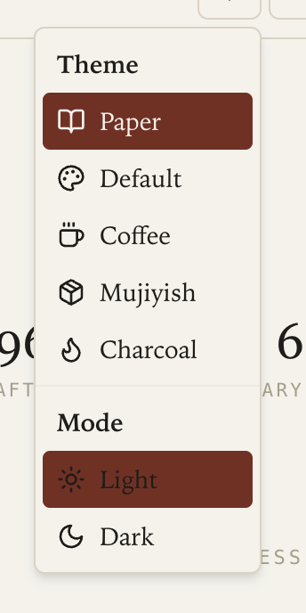

Pick up where you left off section has books from other people whom I don't have access to. I have read them, so the text says "last edited", which is confusing because I have never edited them. I don't have access to anything. This brings the question whether I want these pages, the books which I have been reading from other people in this section. Maybe I do, but then again, do I want to open the app link for that? No, I want to open the library link for that. Currently, it opens the app link even if it's not my book.

The pills, which are used to filter books by Pinned, Published, Drafts, etc., are non-intuitive when it comes to the selected one. It's like the selected one is in italics, which is not enough for understanding that it is the selected one. Also, we want to avoid layout shift when we change the pills selection, so we want to keep the width of these things constant between  selected and unselected states.

"Search in current book" - The search is currently placed at a top level where there is no actual search. This is supposed to be a book search within the book. We want to move it to the book page.

On the books page, "share preview link" and "set as bookmark" do not really work. We can remove them.

"On this page" Close button on this page section is actually kind of overlapping with the fixed menu buttons on top for logging out and settings.We want to probably move that close button further down.

---
we can remove "A book on Pensive" from library books

We want a virtualized list for both published and my books.In fact, we want pagination.We want to be able to scale up to 10,000 books.

The library book pages bookmark button and Text size doesn't really work. We will actually just remove the things which don't work currently or hide them currently.

The Marketing Page has a top nav with a disabled search bar. We don't want the search bar. We can remove it.

The "Pick where you left off" section now says "Last friend for everybody", but it may be better if you say "Last opened".

The filter, search, and sort section, the UI is not really in sync with how the rest of the app is.

- The height of the book cover images was designed for an earlier height, so the change in proportion has caused it to cut off parts of it.
- For pagination, why don't we use an Intersection Observer and load automatically as the user scrolls down?
- The default book cover pattern for books in the library is not ideal. Let's just use a colour.

- In the book's authoring view, the outline view doesn't work well. 
- Desk> Book page> The "drafts","Save this version" ares needs a compact design  - maybe drop-down within the button/better ideas if you have any

- make paper the default theme. remove the current "default" theme.
- remove the muji theme

currently the theme selection is not accessibility compliant. 
- we want  way to get feedback from users easily.
---done---

--active--

---to-do-
- be able to revise the outline, acceptt/repeject each outline element. 
- be able to revise the voice options
- persist voice options generated
---Later--
- Also build a payment portal for publishing paid books. We will show maybe a sample for free. but resgt are gated behnd payment. We should also figure out a way to pay the authors who publish these books for anything they get.

---

