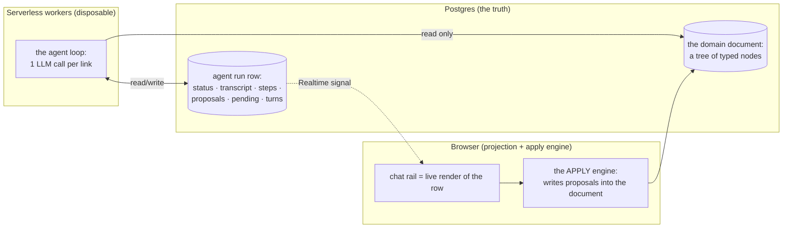
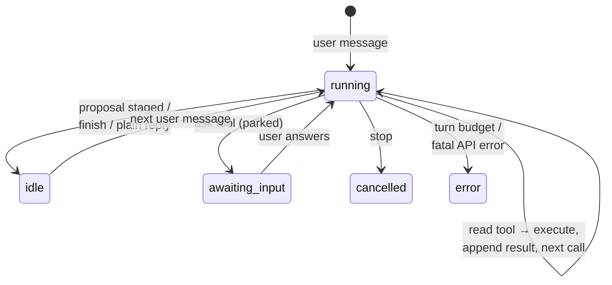
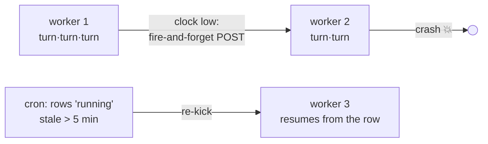
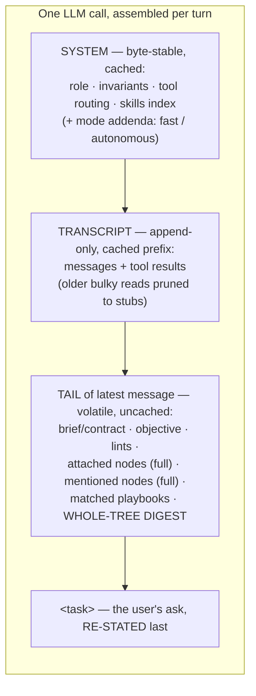
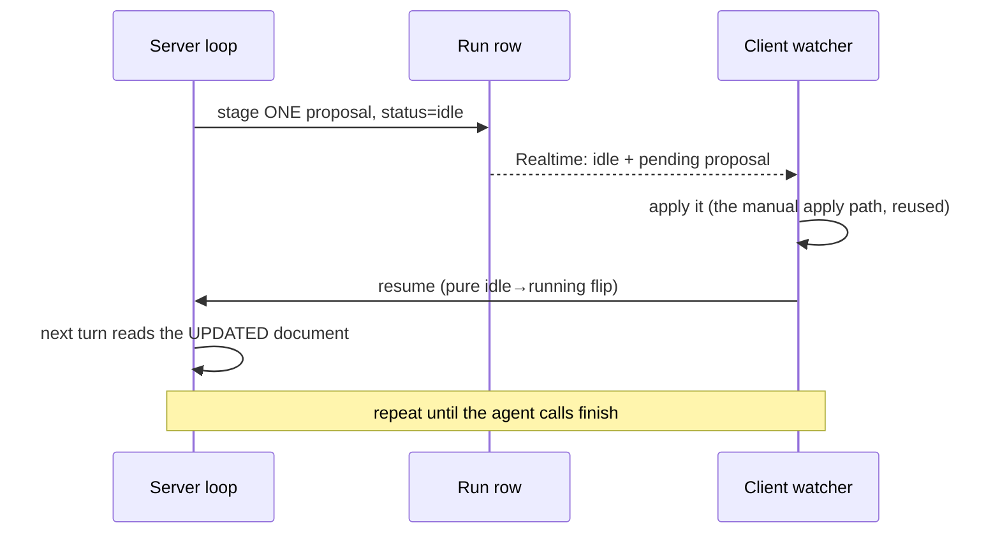

# Inside the Agent — a Builder's Tour

This is the engineering companion to [The AI Editor Agent](/docs/the-agent). That page says what the agent does for an author; this one explains **how it's built**, for someone who understands agents but not this product. Nothing here depends on story generation — swap "book" for any large structured document and the architecture stands.

The one-paragraph summary: it's a **tool-using agent whose entire process state lives in one database row**, driven by short-lived serverless workers that relay themselves (a trampoline), reading a **digest** of the whole domain document every turn and drilling in with read tools, whose only write path is **staged proposals** applied by a separate actor. Everything else is consequences of those choices.

---

## 1. The shape: where each piece lives

Three actors, sharply separated:

- **The row is the process.** Not a cache of it — the process. Transcript (raw LLM messages), human-readable step feed, staged proposals, the parked question, the turn counter, mode flags. Any worker, any tab, any recovery cron resumes from it because there is nothing else to resume from. Pattern name: **externalized / durable state** — stateless compute over stateful storage.
- **Workers are disposable.** Each invocation does bounded work and dies. No worker ever "owns" the agent for longer than one link.
- **The client is two things**: a pure projection of the row (refresh is a no-op by construction), and — unusually — the **apply engine**. The agent decides; the client's existing write paths execute. More on why in §6.

---

## 2. The loop: one turn, one call, an asymmetric state machine

The core is a classic tool loop, but with a deliberate asymmetry baked into which tools continue the loop and which end it.

Each link of the loop:

1. Load the row. Bail unless `status='running'` (someone else's problem otherwise — parked, finished, cancelled).
2. Check the cooperative-cancel flag and the turn budget.
3. **Increment the turn counter *before* the LLM call** — a worker that dies mid-call still burned budget, so a crash-looping run converges on the ceiling instead of being revived forever.
4. One LLM call with the tool belt.
5. Dispatch on what came back:
   - **Read tools** → execute them all, append `tool_result`s, loop again.
   - **Proposal tools** → validate the input, stage the proposal on the row, **end the turn** (`idle`).
   - **Ask tool** → park (`awaiting_input`), stashing the pending question plus any sibling read results so nothing is lost.
   - **Finish / plain text** → `idle`.

Two design points worth stealing:

**Terminal vs. non-terminal tools is the control flow.** The model doesn't decide "should I keep looping" in prose; the *kind* of tool it called decides. Reads continue, writes conclude. That makes the loop legible and makes "one staged change per turn" a structural guarantee rather than a prompt suggestion.

**Idle, not done.** A finished turn ends in a *quiescent* status, transcript retained. That single status choice is what turns a one-shot task runner into a persistent conversation — the next message just appends and re-runs. (`done` exists for genuinely terminal task-style runs elsewhere in the system.)

**Tool-input rejection is self-repair, not failure.** A proposal with invalid input (bad node id, schema violation, touching a locked node) doesn't error the run. The validator's complaint is handed back *as the tool's result*, and the loop continues — the model reads the rejection and corrects itself next call. The turn budget bounds how long it can flail.

---

## 3. The tool belt: four classes, one deliberate exception

The ~13 tools fall into classes with very different contracts:

| Class | Examples | Loop effect | Writes? |
|---|---|---|---|
| **Reads** | read a node in full, full-text search, fetch a schema, load a playbook, web research | continue | no |
| **Judges** | check output against its plan / against the governing contract, audit against the captured vision | continue | no |
| **Proposals** | edit/add/delete nodes, request a generation pass, request a heavy engine pass, offer N alternatives | **end turn** | staged only |
| **Control flow** | ask the user, finish | park / end | no |

Plus one exception: a **direct-write capture tool** (recording the user's own stated intentions into a durable "vision" document). It skips the review gate *because it records the user's words, not the agent's ideas* — the risk a review gate protects against isn't present. A useful rule: gate writes by *whose content* they carry, not by write-ness alone.

Things to notice, generically:

- **The proposal pattern.** The agent has zero mutation authority over the document. Every change is a typed, validated, inspectable object staged on the row; a separate actor applies it through the *same* write path a human edit uses. You get: a human gate when wanted, an audit trail always, one write engine to harden instead of two, and reversibility (checkpoints snapshot the document; applies are discrete events).
- **Granularity is encoded in the ops.** The edit tool speaks several op sizes — merge-edit a node, add, delete, rebuild-all-children-of-a-level, and a tiny `find/replace` for surgical text patches. The descriptions push the model toward the *smallest sufficient* op, and toward batching many small independent ops into one proposal. Op vocabulary is where you teach an agent economy.
- **Delegation as a tool.** Heavy generation passes aren't done by the agent's own context — it stages a *request* for a specialized engine (a separate prompt/pipeline) to run. The agent is a router with taste: it decides *that* and *why*, curates a small steering brief, and the engine does the bulk work. This keeps the agent's turns cheap and lets each engine's prompt be tuned in isolation.
- **Systemic effects ride on the data layer, not the loop.** Example: "rename X everywhere" is one edit op on the entity's node; a database trigger fans the rename out to every occurrence. The alternative — the agent enumerating occurrences and looping text patches — is exactly the kind of N-call grind you should push below the tool boundary whenever the operation is mechanical.
- **Tool descriptions are load-bearing prompt real estate.** The longest strings in the codebase are tool descriptions: when to use this vs. its sibling, the failure mode it prevents ("wrong keys silently orphan data"), batching guidance. Treat them as firmware, not documentation.

---

## 4. Staying alive: trampoline, in-worker driver, watchdog

The runtime constraint: a serverless worker dies at ~150 s of wall clock; an agent turn is many LLM calls. Three mechanisms, one per failure mode:

**Self-chaining (the trampoline).** Do one unit → persist the row → fire an HTTP POST *to yourself* with the run id — resolving on *dispatch*, not completion, with the platform's `waitUntil` keeping the dying worker alive just long enough to hand off the baton. The next unit runs in a fresh worker with a fresh clock. Continuation-passing where each bounce is a new process.

**The in-worker driver.** A pure trampoline pays a reinvoke + cold boot *per LLM call*, which is wasteful when a turn finished in 30 s. So the driver loops turns **in the same worker while budget remains** and only chains at the wall-clock boundary — each continued turn's LLM timeout is set to whatever clock is left, and it refuses to start a turn that can't comfortably fit (an aborted call still bills; better to hand a fresh worker its full clock). Amortized trampoline: durability of the chain, without paying its overhead between fast turns.

**The watchdog.** If a worker dies *between* persisting and dispatching, the chain is severed and the row sits in `running` forever. A cron sweeps every minute: any row `running` and untouched for >5 min gets re-kicked with the same continue call. The threshold is deliberately generous so it never races live work, and it only revives `running` — the quiescent states (`idle`, `awaiting_input`) are *correctly* waiting on a human and must be invisible to the reaper.

Cancellation is **cooperative**: stopping sets a flag; the loop polls it every second during the LLM call and aborts the in-flight request via an abort signal. A parked row has no loop to notice the flag, so it's cancelled by direct status write. (Honest caveat inherited from provider APIs: an aborted call keeps generating and billing server-side — cancellation saves the *next* turn.)

---

## 5. Context engineering: the most transferable part

Every turn, the prompt is assembled from scratch in **two parts with opposite lifetimes**:

- **Byte-stable instructions** (system prompt): role, invariants, tool routing, mode addenda. Identical across every turn of a run — so the provider's prompt cache keeps the prefix warm.
- **Volatile state** (`<book_state>`): the *current* document digest, derived objective, lints, focus content — **rebuilt every call and injected at the tail of the latest user message, never persisted**.

That placement is the key trick. Early versions carried the state at position 0; since the document changes after every applied edit, that invalidated the cached prefix — system prompt plus entire transcript — every turn. At the tail: the stable prefix caches, only the fresh digest is paid uncached, and because it's never stored, the transcript contains exactly **one** current snapshot — the model *cannot* ground on a stale tree, because no stale tree exists in its context. Cache breakpoints are likewise added request-time (first message + latest message), never stored, so they can't accumulate past the API's limit of 4.

The layers inside the volatile block, each a pattern in its own right:

**Digest + drill-down.** The whole document ships every turn — but as one line per node: id, kind, a gist, and the *relational* fields an editor reasons over (dependencies, what it establishes, ordering), with reading-order numbers matching what the UI shows. Full content is one `read_node` away. The digest answers "what exists, what connects to what, what's missing"; reads answer "what exactly does this one say." A map plus a magnifying glass — never the full territory in every prompt. Absence is made legible too: empty fields are dropped so a missing dependency *reads as missing* instead of hiding in a full dump.

**Intent hydration (just-in-time context).** The user's latest message is parsed — deterministically, with regexes over the same numbering the UI displays — for named targets ("scene 14", a node id, an entity name). Matches get their **full content inlined** before the model ever runs, with their ancestor path, child counts, and content schema: everything an edit needs, zero read round-trips. This matters more than it looks: in this architecture a "round-trip" a chat agent would shrug off can be a whole chain link — row write, reinvoke, cold prefill — so pre-loading what the message obviously needs is a first-class latency and cost optimization.

**The focus tray.** Users can explicitly attach nodes; those arrive fully hydrated too, framed as **anchors, not fences** — a phrase used throughout: attached context steers attention but never scopes *away* the rest of the document. (An earlier design that filtered context by aspect was deleted; whole-document visibility won.)

**The task re-stated last.** After all the reference material, the user's current ask is repeated in a `<task>` block as the final thing the model reads. Without it, the last impression before responding is the tree and its lint warnings — and the observed failure was exactly that salience inversion: asked to do X, the agent went off fixing lints. Standard long-context guidance (query after documents), applied.

**Ambient state is labeled by mode.** The same lint report ships as "standing directive — address these" in autonomous mode but "reference — act only if asked" interactively. Same data, different imperative force. Injecting ambient goals as unconditional instructions is how agents hijack their own tasks; a **three-state rule** decides whether the derived objective appears at all — omitted when there's a concrete ask (it would compete), injected when the message is empty/"what's next" (it *is* the ask), always injected in autonomous mode (it's the work queue).

**Skills: progressive disclosure of technique.** The system prompt keeps only invariants plus a one-line index of named playbooks. The full technique text reaches the model through three channels: (1) the always-visible index, (2) **deterministic trigger injection** — regexes over the user's ask pull matching playbook bodies into the volatile tail, (3) a `read_skill` tool for phrasings the triggers missed. The split rule: **safety-critical invariants never live in a skill** (a missed trigger must never cost safety); only technique does. Determinism is deliberate — a retried link re-derives the identical prompt, preserving the resume invariant.

**Transcript compaction.** Long runs accumulate bulky read results that get re-sent every call. Past a size threshold, older bulky `tool_result` bodies are stubbed to one-line pointers ("pruned — re-read if needed") while the **newest bulky message** — the model's current working set — stays intact. Two subtle bugs shaped that rule and are worth knowing: a *count-based* window fails when one batched message carries a whole read sweep (protects everything or nothing), and keying on "newest tool message" fails because tiny post-apply ACKs are also tool messages — the sweep the model still needed got pruned right after every apply, producing a read → apply → re-read-everything loop. Only a message actually *carrying* bulk claims protection. Blocks are replaced, never removed, so tool_use/tool_result pairing survives.

---

## 6. Autonomy: the same agent with the gates automated

Autonomous mode is not a different agent — it's four flag-controlled changes to the same loop:

1. **A mode addendum** in the system prompt: the user is away; carry every request to a committed change; batch independent edits; conclude with `finish`.
2. **Ask never parks.** At a genuine fork the agent still calls the ask tool — but the system answers it *instantly* ("proceed with your stated choice") and journals the question, options, and chosen answer as a **decision step** for later human review. An unattended run can't deadlock, and no judgment call disappears. Decision journaling beats both extremes (blocking forever / silently deciding).
3. **A higher turn ceiling** (100 vs. 20) — change-by-change iteration legitimately needs more turns, but stays bounded.
4. **The apply gate is automated by the client**, which produces this architecture's most unusual loop — a **distributed continuation** crossing the server/client boundary:

Why bounce through the browser at all? Because **the apply engine lives client-side** (including generation passes that stream in the browser to escape the server wall clock), and duplicating it server-side means two write engines to keep honest. The server idles; the client performs the same gesture a human would; the run resumes. One change per turn also means each change is *visible in the document before the next is proposed* — the agent iterates against reality, not against its own plan.

The client watcher carries its own safety kit: single-flight (never act while an action is in flight), hands-off unless the row is quiescent (status is the mutex; the server owns the row while `running`), an exactly-once claim set so a stale row can't double-apply, and **always resume even when an apply fails** — otherwise one poison proposal leaves the run idle-stuck forever, invisible to a watchdog that only revives `running`. The server-side turn budget is *not* reset by resumes, so the client cannot drive an unbounded loop.

**Anti-stall nudges.** Two failure modes observed live, each countered by a sentinel-tagged synthetic user message:

- *The bare-narration stall*: an autonomous turn ends with prose and no tool call ("once that applies, I'll…"). One prod is injected: act or call finish. A **sentinel string** marks the prod; if the previous message already carries it — two stalls in a row — the run goes honestly idle instead of prodding forever.
- *The gather-forever loop*: a task with hits scattered across many places tempts the model to build a complete inventory before acting — while compaction prunes its earlier reads, so it re-reads forever (one live run: 125 steps, 15 turns, 0 changes). Prompt guidance ("work in handfuls") cut the rate; the hard backstop is a **forced commit** after 15 consecutive reads with no proposal: fix what you've already read, now.

The general lesson: **prompt guidance reduces a failure mode; only a mechanical backstop eliminates it.** Sentinels make the harness's own injected messages distinguishable from real user text — so they're excluded when deriving "the user's current ask," and so a nudge can detect its own prior firing.

---

## 7. Latency theater and honest physics

Small passes that shape perceived quality without touching the core loop:

- **Eager ack ("say, then do").** On a fresh message, a fast cheap model produces a one-sentence "here's what I'll do next" note before the real turn starts. It's aggressively fenced: it sees only the latest message plus one line of prior assistant text (so pronouns resolve), is told it cannot see the document, and must never claim findings or state blockers. Scoping the *narrator* model's knowledge is what keeps it from confabulating.
- **Grounding steps.** Context injected silently (hydrated nodes, matched playbooks) is surfaced as visible "Loaded X" activity lines *before* the model call — the user watches grounding happen instead of a spinner. Deduplicated per turn-cluster, because an autonomous run re-injecting the same context every turn once produced ten identical lines of noise.
- **Fire-and-forget side passes.** Chat titling runs off the response path; a failure or slow model never delays the turn.
- **Physics-sized budgets.** `max_tokens` is set to what decode speed × remaining wall clock can actually deliver (~5k tokens at ~55 tok/s inside a 140 s timer), not to ambition — a bigger cap produced turns that died at the timer, were retried verbatim, and died again, in *billed* streaks. Reasoning effort is capped at medium for the same reason. When a loop runs under a hard clock, token budgets are a scheduling decision.

---

## 8. Provider portability and the verify layer

**One chokepoint, Anthropic-shaped.** Every call goes through a single shared LLM module that speaks the Anthropic message shape internally and converts tools/tool_use/tool_result both ways for OpenAI-compatible providers — so the loop runs unchanged on cheap models. Portability tax paid in exactly one place, plus two lessons encoded there: model *roles* are fenced in config (the agent role only ever resolves to a tool-capable model), and the strictest provider sets the contract — OpenAI requires a `tool_result` for *every* tool call, so terminal tools get synthetic "ok" ACKs appended even though Anthropic would close them implicitly. Every call is also logged to an audit table with its function, task, and user attribution — the raw material for cost accounting and offline evaluation.

**Generate → verify.** In autonomous mode, after a generation pass lands, the next turn is preceded by an injected **plan-conformance verdict**: a judge pass comparing the output against the node's own declared plan, pushed into the transcript as the thing the model reads next. Two refinements worth copying: the judge reads *resolved* references (the actual promise text, not an id hash), and known data-duplication artifacts are scoped out before judging — a false FAIL teaches the agent to *dismiss the verifier* (alarm fatigue), which quietly defeats the whole layer. A verifier's credibility is a resource; spend it only on true positives.

---

## 9. The named patterns, in one table

| Pattern | Where it shows up here |
|---|---|
| Externalized/durable state | the run row *is* the process; workers are disposable |
| Terminal vs. non-terminal tools | reads continue the loop, proposals/asks/finish end it |
| Proposal / staged-write (plan–apply split) | agent stages typed changes; a separate actor applies via the one write path |
| Self-chaining trampoline + `waitUntil` | beating the worker wall clock, one LLM call per link |
| Amortized continuation (in-worker driver) | back-to-back turns in one worker until the clock runs low |
| Watchdog / reaper, quiescent-state exemption | cron revives stale `running` rows only |
| Cooperative cancellation | flag polled mid-call, abort signal on the in-flight request |
| Count-before-call budget accounting | crash loops converge on the ceiling |
| Rejection-as-tool-result (self-repair) | invalid proposals bounce back as feedback, loop continues |
| Prompt-cache prefix discipline | stable system + transcript prefix; volatile state at the tail, never persisted |
| Digest + drill-down | whole document as one-line-per-node map; full content via read tools |
| Intent hydration / JIT context | deterministic parse of the ask → full content pre-inlined |
| Anchors, not fences | attached/focus context steers, never scopes away the rest |
| Query-after-documents | the ask re-stated as the final block |
| Three-state objective injection | ambient goal omitted / injected / mandatory by mode |
| Progressive disclosure (skills) | index + trigger injection + self-serve read tool; invariants never in skills |
| Transcript compaction, working-set protection | stub old bulky reads; protect the newest bulky message |
| Decision journaling | autonomous forks answered instantly, recorded for review |
| Distributed continuation | server idles → client applies → client resumes |
| Status-as-mutex, single-flight, exactly-once claims | shared-row ownership between server and client watcher |
| Sentinel-tagged synthetic messages | anti-stall prod, forced commit, verify injection — all self-identifying |
| Mechanical backstops over prompt hope | forced commit after N reads; one-prod-then-idle |
| Say-then-do (eager ack) with a fenced narrator | fast acknowledgment model that cannot claim findings |
| Provider chokepoint, strictest-contract rule | one conversion layer; synthetic ACKs for every tool call |
| Generate↔verify with credibility budgeting | plan-conformance judge; false-positive sources scoped out first |

For the runtime substrate in more depth (Realtime signal-vs-truth, the TOAST gotcha, row-merge rules), the repo's `docs/agent-runtime-architecture.md` is the plumbing-only deep dive. For what all this machinery is *for*, go back to [The AI Editor Agent](/docs/the-agent).
