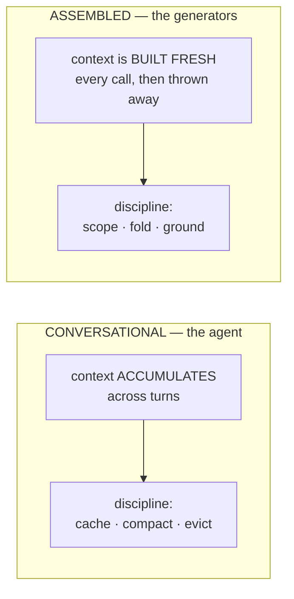
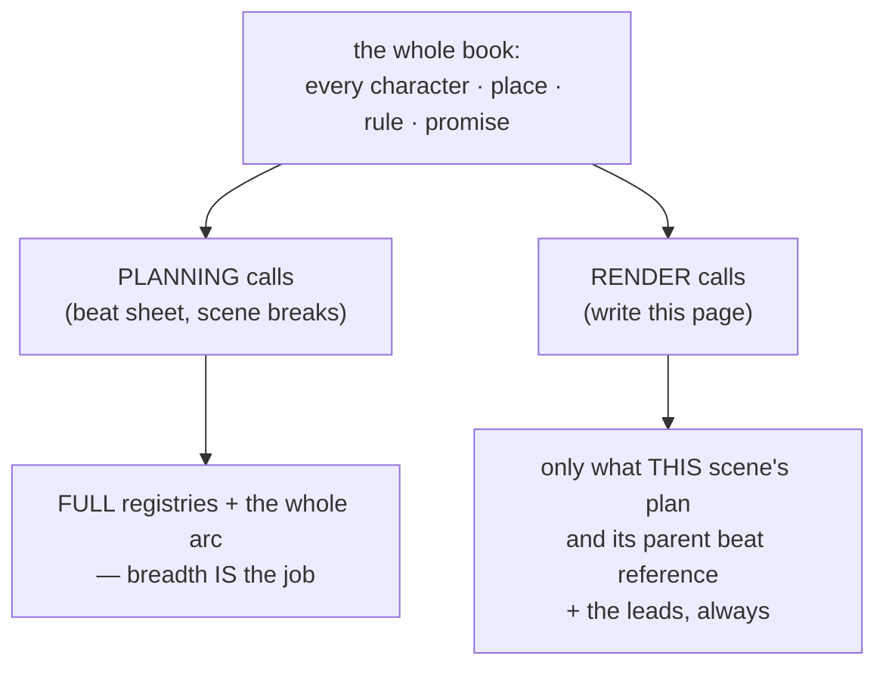
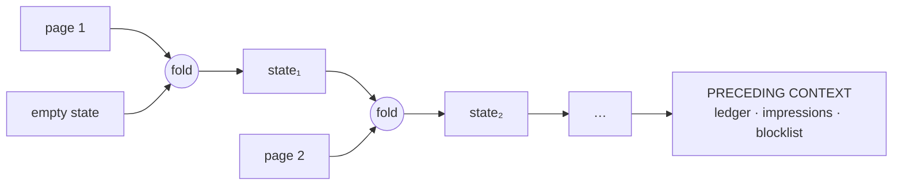
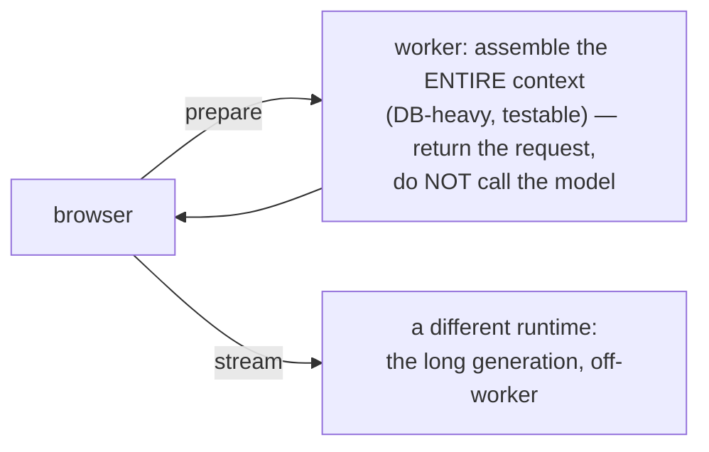
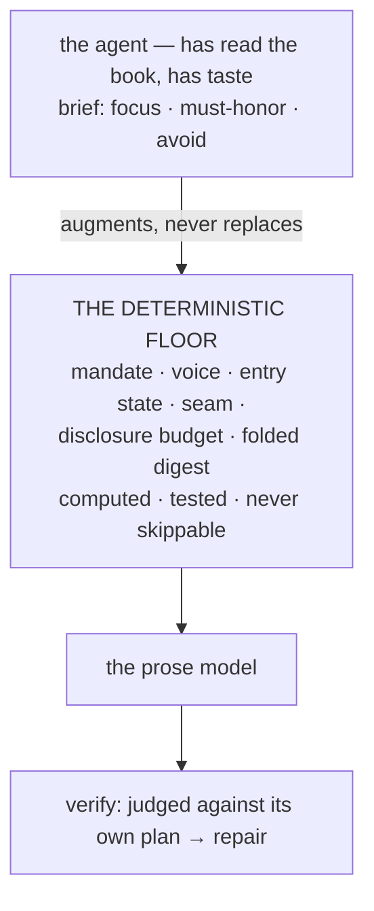

# Context Engineering — the Agent and Its Generators

A book does not fit in a context window. Neither does its tree, its cast, its every prior page. So **every AI call in this system is a curation decision**: what, out of everything that exists, goes in front of the model *for this call*.

This is the deep-dive on those decisions. [Inside the Agent](/docs/agent-internals) §5 introduces the agent's own prompt assembly; this page extends it and then covers the half that page doesn't — the **generators**: prose rendering, the continuity digest, the judges. Nothing here is story-specific. Swap "book" for any large structured document and the architecture stands.

The organizing insight: there are **two kinds of context, with opposite disciplines.**



An agent's hard problem is that its context grows without bound. A generator's hard problem is that its context starts empty every time and must be *reconstructed* from a document too large to include. Confusing the two produces agents that drown and generators that hallucinate.

---

## 1. The agent: a window that grows

### The two lifetimes

Every turn, the prompt is assembled from scratch in two parts that are never concatenated into one string:

| part | contents | position | lifetime |
|---|---|---|---|
| **instructions** | role, invariants, tool routing, skills index, mode addenda | system, position 0 | byte-stable across a whole run |
| **book state** | tree digest, objective, lints, ledger, attached nodes, matched playbooks | tail of the latest user message | rebuilt every call, never persisted |

Placement is the whole trick. Early versions carried the state at position 0 — and because the tree changes after every applied edit, that invalidated the cached prefix (system prompt *plus* the entire transcript) on every single turn. Moved to the tail: the stable prefix stays warm, only the fresh digest is paid uncached.

The second benefit is subtler and arguably larger. Because the state is **never stored** into the transcript, the window contains exactly **one** snapshot of the document — the current one. The model cannot ground on a stale tree from three turns ago, because no stale tree exists anywhere in its context. Freshness stops being a prompt instruction and becomes a structural guarantee.

### Digest and drill-down

The whole tree ships every turn — as one line per node.

```
[n_k2p9] L3 beat 7/41: Mara trades the map for passage. ·
  {"connector":"therefore","polarity":"down","needs":["mara_has_map"],
   "establishes":["mara_owes_captain"],"threads":[…]} 
[n_x9f2] L4 scene 14/80: {"goal":…,"value_shift":…} · prose: "1,240w"
```

Each line carries the node's *gist* plus its **relational spine** — what it depends on, what it establishes, how it connects, where it sits in the order. Not its full content: full content is one read tool away.

Three deliberate properties:

- **The digest answers different questions than a read.** "What exists, what connects to what, what's missing" versus "what exactly does this one say." A map plus a magnifying glass — never the full territory in every prompt.
- **Empty fields are dropped, not nulled.** A beat with no causal connector *reads as floating*. Serialize it as `null` and the gap hides inside the dump.
- **Reading-order numbers are shared.** `beat 7/41` is computed over the same walk the UI and the renderer use, so "beat 7" denotes the same node to the model, to the interface, and in the finished book. Before this, the agent inferred numbers from an unrelated pointer and referred to scene 14 as "scene 17" — a failure of *shared denotation*, not of reasoning.

### Absence needs its own channel

The tree is **dense**: every slot the structure template knows about exists as a real row, empty until written. That turns absence from a *shape* (no row) into a *value* (a row saying nothing) — and absence-as-value fails open.

An empty node rendered inline does two kinds of damage. It reads as an **asserted fact** — `- [?] {}` under a character says "this character has no want," not "nobody has written this yet." And it acts as a **format exemplar**: a run of blank rows measurably lowers the model's fill rate on the nodes that *do* have content. The damage spreads past the stubs.

The resolution is placement, not visibility — and it differs by consumer:

| consumer | treatment | why |
|---|---|---|
| by-name registries (cast, places, rules) | **omitted** | a nameless row is strictly worse than no row for a lookup |
| ordered sequences (the acts) | **kept, explicitly marked** | position is information — drop empty acts and a three-act book reads as one act, and the generator writes the middle as if it were the whole story |
| the agent's tree digest | **kept, collapsed** | placeholders are its *work queue*; it fills a slot by targeting that slot's id |
| the reader-facing render | never present | nobody reads "Chapter 4: yet to be filled" |

Then the same emptiness is stated **once, in its own voice**:

> STILL UNWRITTEN (3 acts · 12 beats · 40 scenes) — slots that exist in the book's plan but hold no content yet. The book does NOT end where the written material ends.

Counts, never ids — orientation, not a to-do list. The danger was never that a model *sees* emptiness; it's that it *misreads* emptiness as completion and starts wrapping the story up.

### Just-in-time hydration

Two channels inline **full** content for the nodes that matter *this turn*.

**The focus tray** — nodes the author explicitly attached. **Intent hydration** — nodes the author's latest message names, by reading-order number, by id, or by an entity's name, matched deterministically against the same numbering the UI shows, capped at four.

A hydrated node arrives **edit-ready**, carrying the three things every edit needs:

```
[n_x9f2] scene 14/80 "The auction"
path: pillar › act "Descent" › beat "The captain's price" › scene   ← POSITION (ancestors are fixed)
  · children: 3 scenes (an edit here STALES them)                   ← BLAST RADIUS
{ "goal": …, "value_shift": …, "pov": … }                           ← CONTENT
prose (1,240w): …                                                    ← the text itself, for scenes
+ the kind's exact field schema                                      ← so an edit can't silently orphan data
```

Long prose keeps **head and tail** with the middle elided — the two edges a continuity or wording question actually reasons about.

This matters more than it looks. In a durable-loop architecture, a "round-trip" a chat agent would shrug off costs a whole chain link: a row write, a cold worker reinvoke, a full prefill. Pre-loading what the message obviously needs is a first-class latency and cost optimization, not a nicety.

### Injection policy is the engineering

Not everything ships every turn. Three examples where *when to inject* mattered more than *what to inject*:

**The derived objective — three states.** The guided-flow anchor ("the next rung of the book") once rode every turn, so a concrete ask arrived beside a standing "do the next rung instead" instruction. Now it's omitted when there's a concrete ask (it would compete), injected when the message is empty or "what's next" (it *is* the ask), and always injected in autonomous mode (it's the work queue). Plus one deliberate exception: during the opening interview there *are* no typed asks — the author is just talking — and without the objective the agent improvised the interview and never found its ending.

**Lints — same data, different imperative force.** The identical lint report ships labelled *"the structural backstop — address any flags"* in autonomous mode and *"for reference — act on one only when the author asks"* interactively. Injecting ambient goals as unconditional instructions is how agents hijack their own tasks.

**Skills — progressive disclosure of technique.** Fourteen craft playbooks reach the model through three channels: an always-visible one-line index; deterministic trigger-matched injection of the matching body; and a read tool for phrasings the triggers missed. The split rule: **safety invariants never live in a skill** — a missed trigger must never cost safety; only technique moves out. And a state override — while the author is still discovering their story, one playbook is pinned and ask-triggered ones are *suppressed*, because a mid-interview answer ("my protagonist is a lighthouse keeper") is a concrete message whose story nouns otherwise trip the node-editing playbooks.

### The ask goes last

Every block is wrapped in its own tag carrying a note that says **how to use it**, not just what it is. Then the author's ask is re-stated *after* the entire state dump:

```
<book_state> … the tree, the lints, the ledger, the playbooks … </book_state>

<task note="the author's CURRENT ask — THIS is your job this turn;
            everything in book_state above is reference, not instruction">
render scene 14
</task>
```

Without it, the last thing read before responding is the tree and its warnings — and the observed failure was exactly that **salience inversion**: asked to render a scene, the agent went off fixing lints. Standard long-context guidance (query after documents), applied.

### Eviction: compaction, and a mechanical backstop

Long runs accumulate read results that get re-sent every call. Measured: fourteen full scene reads ≈ 50k tokens re-sent on every subsequent call; past a threshold most calls blew the provider timeout and the loop crawled at roughly one successful turn per four attempts.

Compaction stubs older bulky tool results to one-line pointers while the **newest bulky message** — the model's working set — stays intact. Two bugs shaped that rule, and both generalize:

- A *count-based* window fails when one batched turn packs a whole read sweep into a single huge message — it protects everything or nothing.
- Keying on "the newest tool message" fails because a tiny post-apply acknowledgement is *also* a tool message. Protection flipped to the ack right after every apply and pruned the sweep the model still needed. It re-read everything, fixed one thing, lost it again.

So: only a message actually *carrying* bulk claims protection. Blocks are replaced, never removed, so tool-call/tool-result pairing survives.

Compaction alone wasn't enough. Because pruning removes earlier reads *before they're used*, an agent trying to build a complete inventory before acting can loop forever — one observed run: 125 steps, 15 turns, **zero** changes. Prompt guidance ("work in handfuls, don't sweep") cut the rate but didn't stop it. The fix is mechanical: after a run of consecutive reads with no commit, the harness injects a forced commit.

> **The general lesson:** when a failure mode is a *loop*, prompt guidance reduces its frequency; only a mechanical stop removes it.

### Anchors, not fences

One governing decision underpins all of the above: attached context **seeds** attention, it never scopes anything away. The whole tree is always visible; every unlocked node is editable. An earlier design that filtered context by aspect was deleted — whole-document visibility won, and the review gate provides the safety that scoping was pretending to.

The one real limit is a **capability boundary, not a scope boundary**: the agent never writes full prose, because prose generation is a browser-orchestrated stream that a server-side tool loop physically cannot drive. So it *requests* a render; the client executes it. That distinction — "can't reach it" versus "not allowed to touch it" — is worth keeping crisp, because the two call for completely different designs.

---

## 2. The generators: a window built from nothing

Prose rendering, structural expansion, and the judges are **one-shot calls**. Nothing accumulates, so nothing needs evicting. The entire discipline is assembly — reconstructing, in one prompt, enough of a book to write the next page of it without contradicting the previous three hundred.

### One-shot is not context-free

Worth separating, because the two get fused: *stateless* is a claim about accumulation, not about payload. A render inherits no conversation, but it is not handed nothing — and one of the things it's handed comes from the agent.

Almost everything in a render prompt is **re-derived from the tree at call time**: both sides read the same store, so no handoff is needed. But the agent's turn contains something the store doesn't have — what the author just said, and what the agent found by reading and grepping. That crosses the boundary through exactly one typed channel, the **editor's brief** (`focus` · `mustHonor[]` · `avoid[]`), described to the agent as: *the pipeline already has the voice, the mandate, and a digest of every prior page — your job is to add what it can't compute.*

Four properties make it a channel rather than a leak:

- **Serialized, not shared.** It's stored on the proposal, so it survives the author's review gate and a process hop — the agent's turn is over and the render runs in the browser.
- **Additive, never substitutive.** It's injected *on top of* the computed context, and ranked explicitly below the mandate and locked facts. The agent buys salience, not authority.
- **Bounded at the trust boundary.** Trimmed, focus capped, lists sliced — the agent is an untrusted producer of context.
- **Not prose-only.** A sketch or a beat-sheet expansion is steerable the same way.

The cost is honest: the author's message reaches the render *only* as whatever the agent distilled. That's a lossy compression channel with a model in the middle, and nothing downstream can detect an under-curated brief — which is why the brief is shown in the proposal card before Apply.

### Scope by what the plan names

The single biggest move: a render target gets a **scoped bible**, not the whole book.



A scene renders one moment; it doesn't schedule promises across the arc. Broadcasting every character and location to a render costs tokens *and* dilutes the signal with cast who aren't in the room. So the scope is derived from the plan itself — the cast it names, the promises its parent beat carries, the world rules that beat grounds itself in — with the leads always included as insurance, since a single-shot call cannot go fetch what the plan under-named.

A planning call gets the opposite treatment, for the same reason: breadth is precisely its job.

### The full stack, in order

```
BOOK · BRIEF (binding) · MANDATE (non-negotiable) · VOICE PROFILE
STORY SO FAR .............. the ancestor chain; locked items marked immutable
SCOPED BIBLE .............. cast / promises / rules this scene actually touches
BEAT PLAN ................. sibling beats, so prose can't contradict the plan next door
ENTRY STATE ............... open promises + where each character last stood
SETTING ................... the location's persistent sensory palette
DISCLOSURE BUDGET ......... which details are fresh, which are worn out
REGISTER .................. how the one voice bends for this scene only
THE SKETCH ................ the accepted treatment: opening · moves · exit · direction
THE EDITOR'S BRIEF ........ the agent's curated guidance, verbatim
THE SEAM .................. the previous scene's actual last paragraphs + how to join
PRECEDING CONTEXT ......... the folded digest of everything before  (§2.3)
STILL UNWRITTEN ........... don't wrap the book up early
THIS NODE ................. the plan being rendered
```

Two of these are unusual enough to name.

**The disclosure budget** turns "describe the setting" into an accounting problem. For each entity in the scene, the prompt states which of its facets have already been rendered, how many times, and the last phrasing used:

```
The harbour:
  smell — saturated (×6) — last "brine and diesel":
      do NOT restate; an oblique echo at most, and only if the scene turns on it.
  light — established ×1 ("low, silvered"): fine to touch again, but in NEW words.
```

Anything *not* listed is unrendered — "this is your chance to establish it." Progressive disclosure applied to world detail rather than to instructions: the model stops re-describing what the reader already knows, which is one of the most recognizable tells of machine-written prose.

**The seam** carries the previous scene's *actual final paragraphs* (or its planned exit, if undrafted) plus an explicit instruction for how this scene joins them. It costs no model call, so it rides even the fast path. Critically it is kept **distinct** from the voice-reference block: an earlier fused block conflated "continue from here" with "sound like this," and prose kept re-telling the previous page instead of moving past it.

### The digest: a fold, not a summary

Prior prose cannot be pasted in — and measurement showed the verbatim previous page is the single largest source of repetition anyway. So the past enters as a **rolling fold**.



Each fold sees only *(cumulative state, one new page)* — never the whole book. Cost is constant per page instead of quadratic.

Each link is **cached on the page's own node** and **hash-chained**: one hash over this page's prose, another over the accumulator it folded onto. Edit page 5 and only pages 5 onward re-fold; everything before is untouched. A version counter invalidates the entire chain when the shape or the model changes — a digest built by a weaker model is re-derived, never trusted. Folds run on a *reasoning* model rather than the cheap tier, deliberately: this is read-comprehension that all downstream prose treats as authoritative, so one misreading poisons every later page.

The digest ships as three channels, and the separation is the point:

- **the ledger** — cumulative state, *grounded*: every entry carries the id of the node it concerns, so epithets and pronouns resolve to a real character instead of minting a parallel one;
- **impressions** — what *resonates*, weighted. Not every fact: the reader's memory of the read, so prose stays loyal to what the book feels like, not only to what is literally true;
- **a blocklist** — distinctive phrases already used, which the next page may not reuse.

Result: comparable continuity at roughly a third of the tokens of an all-pages baseline.

### The judge's context

Verification has its own assembly problem. A judge is given a **plan slice** — the scene's structural commitments with promise ids resolved to their actual names and promises, so it reads the promise rather than a hash.

One scoping fix generalizes well. A promise is paid *once*, but plans sometimes copy the same promise reference onto every child scene. Judging all of them fails the ones that legitimately don't deliver it — and an agent that receives false alarms learns to dismiss the verifier entirely. **Alarm fatigue is a context bug**, not a UX one. So payoff judgment is scoped to the last scene that still carries a given reference.

### Where the boundary falls is also a context decision

The serverless worker has a hard wall-clock ceiling that was killing over half of prose calls. The fix splits the call exactly at the context boundary:



The expensive, database-bound, twin-tested assembly stays where it belongs; only the long generation leaves. Worth noticing as a general move: when infrastructure limits force a split, splitting at the *context assembly* seam preserves testability, because assembly is the part with all the invariants.

---

## 3. The handoff: judgment on top of a floor

The agent cannot write prose — but it can curate the prose call's context. Its render request carries a brief: **focus**, **must honor**, **avoid** — injected verbatim as the highest-priority guidance for that page.

The framing is exact, and it is the architectural claim in miniature:



The brief **augments** the computed context and can never override the binding mandate or a locked fact. Deterministic context is the floor — always present, unit-tested, identical on a retry. The agent's judgment is a layer on top.

This is the general pattern for mixing learned judgment with computed context: **let the model add, never let it subtract.** An agent that can *remove* grounding will eventually remove the piece that was holding the whole thing together.

---

## 4. Eight principles

1. **Curate at write time, not read time.** The digest, the ledger, the disclosure budget and the fold are precomputed projections. The model never spends turns assembling its own view.
2. **Anchors, not fences.** Scoping shapes attention; the review gate provides safety. Confusing the two produces agents that are both restricted *and* unsafe.
3. **Absence needs a channel.** Omitted content must be announced, or omission reads as completion.
4. **The query goes last.** Reference first, ask last — or the reference becomes the ask.
5. **Cache-prefix discipline.** Byte-stable at position 0; volatile at the tail. Anything that changes per turn must never sit early.
6. **Every optional block degrades to empty.** New context is additive and can never break the path that existed before it.
7. **Deterministic assembly.** Regexes, hashes, stable ordering — nothing random, nothing time-dependent. A retried call re-derives a byte-identical prompt, which is what makes resume safe.
8. **Shared code, parity-locked.** Context renderers used by both the server and the client are tested for byte-identical output. A second copy of a prompt builder is the most expensive kind of duplication there is.

---

## 5. Adding a new block: the checklist

1. **Which consumer?** Agent digest, planning generator, render generator, judge, reader-facing render. They need genuinely different treatments — especially of emptiness.
2. **Digest or full?** Default to a digest line plus a tool to fetch the rest. Inline full content only for what the call is *about*.
3. **Where does it sit?** Volatile at the tail; stable in the system prompt. Never the reverse.
4. **Own tag, plus a note saying how to use it.** "Honor this" versus "for reference" is often the entire behavioural difference.
5. **Could it compete with the ask?** If so, gate its injection rather than always sending it.
6. **What does empty look like?** Compute to nothing — and add an explicit absence channel if the omission could read as completion.
7. **Is it deterministic?** If it depends on time or randomness, resume breaks.
8. **Test it.** If it renders content shared across runtimes, lock it with a parity test.

---

Companion reading: [Inside the Agent — a Builder's Tour](/docs/agent-internals) for the runtime the agent lives in, [The AI Editor Agent](/docs/the-agent) for what all this is *for*, and [How It Works](/docs/how-it-works) for the structure being curated. The repo's `docs/dna-context-engineering.md` is the file-level companion — the same material annotated with source paths and line numbers.
