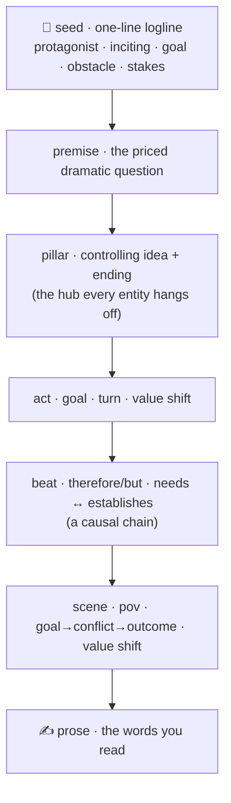
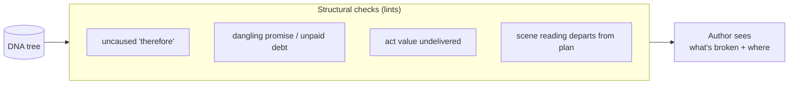
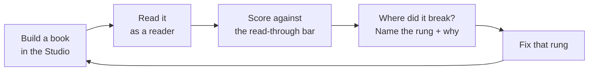

# How It Works — The DNA Method

A book in Pensive is not a pile of pages. It's a **self-similar tree** — the story's DNA — and the pages you read are a *render* of that tree. The tree is the single source of truth; change the tree, and the book re-renders.

---

## The ladder

Every book is grown down a fixed ladder of resolution. Each rung is generated **from the rung above it**, so nothing floats free of the story's intent.

| Rung | What it fixes | Who creates it |
|---|---|---|
| **seed** | The one-line logline — the story in a sentence | Author, with AI help (an *idea* ≠ a *logline*) |
| **premise** | The dramatic question the book is really asking | AI, from the seed |
| **pillar** | The controlling idea + the ending everything points at | AI + author locks |
| **act** | The macro pressure curve — how value swings act to act | AI, one pass |
| **beat** | The causal chain — each beat *needs* state earlier beats *establish* | AI, one global beat-sheet pass |
| **scene** | The unit of drama — a value shift, POV, place | AI, per beat |
| **prose** | The actual words, in the book's voice, with full continuity | AI render, streamed |

---

## Why structure-first

The load-bearing idea is that **structure is data you can check**. Because beats declare what they *need* and what they *establish*, the whole book forms a **causal graph** — and the system can verify, mechanically, that every "therefore" is earned by something upstream. A beat with no cause reads as floating; a promise with no payoff is a dangling thread. These are *lints* on the story, the same way a compiler lints code.

This is what lets AI *hydrate* the book instead of free-writing it: the plan constrains every generation, and the checks catch the plan's own gaps before a single word of prose is written.

---

## Structure begets structure

From a one-line seed, the system can grow the whole tree down to prose — and back **up** a level into a **series**: a book's canon is carried forward as a hard constraint on its sequels. The same tree that renders one book seeds the next.

---

## The evaluation loop

We don't admire the pipeline — we judge the artifact.

When read-through stops, we name the rung that broke it — was the *beat* causal-but-flat? the *scene* shift missing? the *voice* generic? — and that rung becomes the next sprint. The structural lints catch craft failures cheaply; the human read is the ground truth.

---

Next: **[The AI Editor Agent](/docs/the-agent)** — the collaborator that walks you down this ladder.
