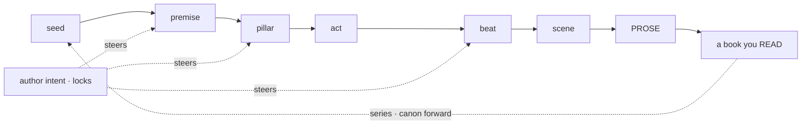

# What Pensive Is

**Pensive turns a one-line idea into a book you actually want to read — by generating *structure* first, then hydrating that structure into prose with AI.**

Most AI writing tools free-write prose and leave you babysitting continuity by hand. Pensive inverts that: it builds a story's skeleton — its **DNA** — and grows the book downward from it, one rung at a time, with the author steering at every level.

---

## The bet

> With enough **structure** — a DNA — and a way to **hydrate** it with AI and **grow** more structure from it, a book (and then a series) can be generated that a person will simply read.

This is a narrow, testable claim. Not "can AI write prose" (it can, badly, everywhere). The bet is that *structure is the leash*: each layer of the book is generated **from the layers above it** plus locked author intent, so the AI elaborates a plan rather than inventing a new story every paragraph.

---

## Who it's for

| | **AI-native authors** | **Story-first authors** |
|---|---|---|
| **Who** | Already use AI tools; copy-paste generated prose in from elsewhere | Have stories to tell; not fluent in prompting or AI workflow |
| **Pain** | No structure — disconnected prose blobs, continuity by hand | Blank page; don't know the moves of story craft |
| **What Pensive gives** | A living structure the prose is generated *from* | Guided craft: the system knows the moves, and prompts the next one |

---

## The bar for "it works"

**The read-through test:** *Can the target reader read a generated book end-to-end and not want to edit it?*

We measure three things, and nothing else counts as a top-level win:

1. **Read-through depth** — how far you read before the edit-reflex kicks in ("I'd change that line").
2. **Generation ease** — how few *decisions and corrections* it took to get there.
3. **Step intuitiveness** — at each step, did you know what to do and why, without being told.

A feature that doesn't move one of these three is a distraction, not a priority.

---

## How the pieces fit

- **[How It Works — the DNA Method](/docs/how-it-works)** — the seed→prose ladder, and why structure-first is the whole idea.
- **[The AI Editor Agent](/docs/the-agent)** — the one AI collaborator that discusses the book, proposes changes, and never touches the manuscript without you.
