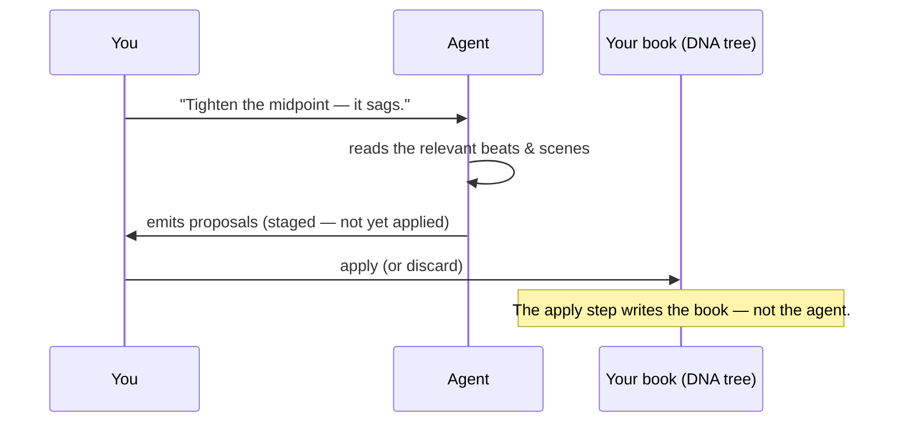
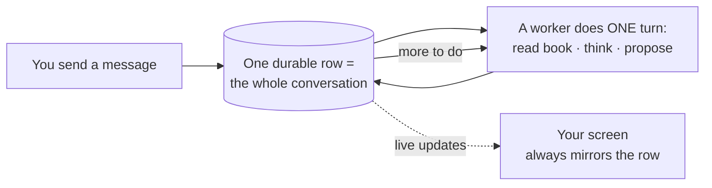

# The AI Editor Agent

Pensive has **one** AI collaborator per book: a tool-using story editor that holds the whole DNA tree in mind, discusses it with you, and works by *proposing* changes rather than editing your manuscript in place — like an editor who can also draft.

---

## Proposing and applying are separate steps

The agent is **read-only on your book.** It can look at anything, but it can't mutate the manuscript — every change it wants to make is emitted as an explicit **proposal**, and a separate *apply* step is what actually writes it. Nothing edits the book as a side effect of the agent thinking.

Who performs that apply step depends on the mode:

- **Collaborative** — *you* apply. You see each proposed change and Apply or discard it.
- **Autonomous** — an *automatic* apply step commits each change as the agent goes, so a long build doesn't wait on you. It's the same proposal-then-apply path, just with the gate automated.

The point isn't that a human blesses every edit — in autonomous mode, deliberately, no one does. It's that every change is a **discrete, inspectable, reversible event** rather than an opaque in-place rewrite: each proposal is recorded, checkpoints let you roll the whole tree back, and any fork the agent decided on its own is journaled for you to revisit.

---

## What it can do

The agent works with two kinds of tools:

- **Reads** — it explores your book: search the tree, read a node in full, check a scene's prose against its plan and against your brief.
- **Proposals** — the only way it changes anything, each staged for your review:

| Proposal | What it does |
|---|---|
| **Edit nodes** | Add / edit / delete parts of the structure |
| **Render prose** | Ask the prose pipeline to (re)write a scene in your voice |
| **Expand a rung** | Delegate a heavy pass — generate the whole beat sheet, break a beat into scenes |
| **Offer options** | Stage 2–4 alternatives for you to pick between |

It can also **ask you** a genuine creative-fork question (and pause until you answer), or **finish** its turn when discussion alone answered you.

---

## How it stays alive

A long editorial pass can outlast any single server request. Pensive solves this by making **the conversation itself durable** — the entire state of the agent lives in one database row, not in server memory. A worker picks up the row, does one step of thinking, writes it back, and hands off. Close the tab, lose your network, come back tomorrow — the agent resumes exactly where it was.

*Because the row is the source of truth, refreshing the page is a no-op — the screen is just a live projection of the row.*

---

## What it sees each turn

Every turn, the agent is handed a fresh, grounded picture of your book:

- **Your brief** — the binding voice-and-genre contract it must honor.
- **The whole DNA tree** — as a compact digest, so it always reasons over the *current* book.
- **What you pointed at** — nodes you attached, or named in your message, arrive pre-loaded in full.
- **The story's open state** — dangling promises, where characters stand, the structural lints.
- **Matched craft playbooks** — the right technique for the job you asked for, injected automatically.

That grounding is what keeps the agent *on your ask* instead of drifting into generic advice.

---

## Two modes

- **Collaborative** (default) — it discusses, proposes, and waits for you. A real back-and-forth.
- **Autonomous** — for a "build the whole thing" run, it commits its own choices change-by-change and only stops to ask at a genuine story fork. Every fork it decides is journaled for you to review later.

---

For the structure the agent operates on, see **[How It Works — the DNA Method](/docs/how-it-works)**.
