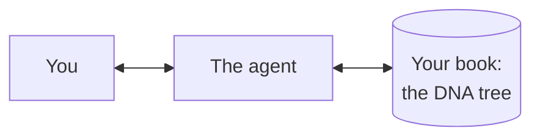
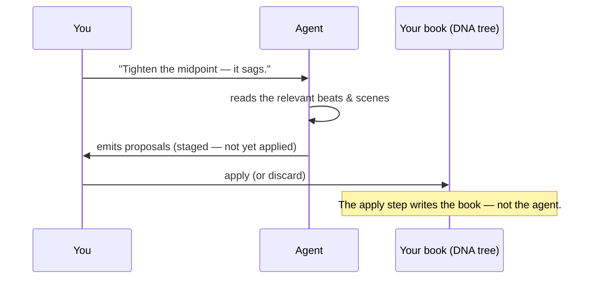
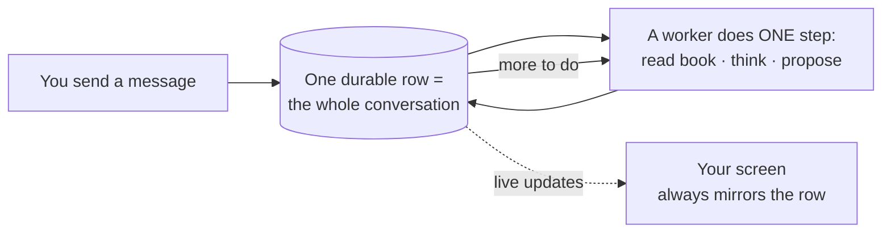
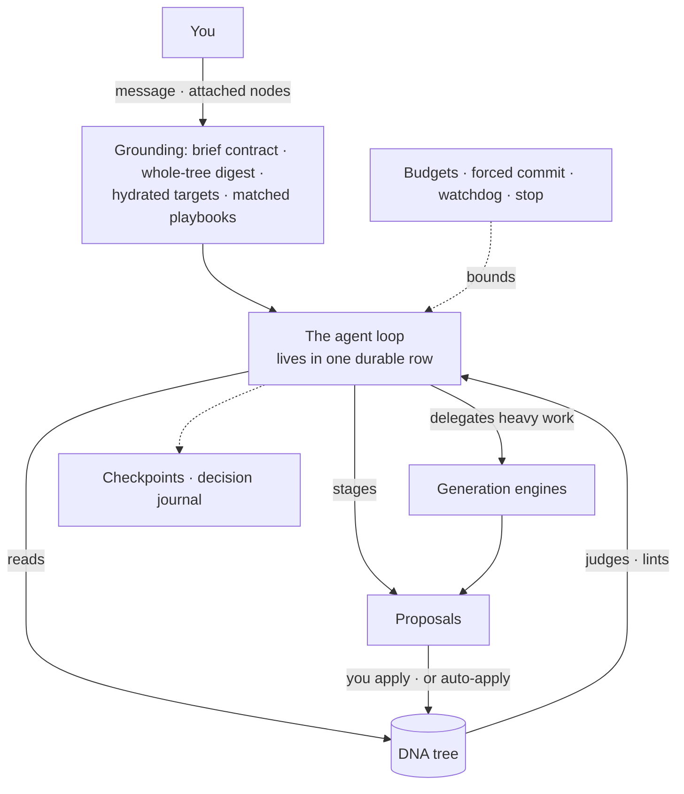

# The AI Editor Agent

Pensive has **one** AI collaborator per book. This page builds your picture of it the way you'd build a house of cards: start with a model small enough to hold in one breath, then add exactly one card at a time — each card introduced by a problem the model you already have can't solve.

If you stop reading at any card, what you're left with is still true. Just coarser.

---

## Card 0 — The whole thing

You talk to the agent. The agent works on your book's **DNA tree** — the structured skeleton the book is generated from (premise → acts → chapters → scenes → prose).

**Your model now:** `You ⇄ Agent ⇄ Tree`

That's the honest shape of it. Everything below is a fix for something that shape gets wrong.

---

## Card 1 — The agent is not allowed to touch your book

**The problem.** In the model above, the agent writes straight into your tree. So a single sentence from you — *"tighten the midpoint"* — can silently rewrite twelve scenes. You have no idea what changed, no chance to disagree, and no way back. Trust becomes all-or-nothing.

**The new idea: proposals.** The agent is **read-only on your book.** It can look at anything, but it cannot mutate anything. Every change it wants to make is emitted as an explicit **proposal** — a typed, inspectable object — and a separate **apply** step is what actually writes the tree. Nothing changes as a side effect of the agent thinking.

**Your model now:** `You ⇄ Agent → proposal → apply → Tree`

*(Architectural name: the **plan/apply split**, the same separation Terraform makes between "here's what I would change" and "now do it.")*

---

## Card 2 — Someone has to press apply, and it can't always be you

**The problem.** A whole book is hundreds of proposals. If every one waits on a human click, "build me a draft" becomes a thousand-click afternoon. But removing the gate entirely puts you right back at Card 0.

**The new idea: automate the gate, not the record.** The proposal→apply path stays exactly the same; only *who performs the apply* changes.

- **Collaborative** (default) — you apply. You see each proposed change and Apply or discard it.
- **Autonomous** — an automatic apply step commits each change as the agent goes, one at a time, so a long build doesn't wait on you.

The point was never that a human blesses every edit — in autonomous mode, deliberately, nobody does. The point is that every change stays a **discrete, inspectable, reversible event** instead of an opaque rewrite:

- every proposal is recorded in the conversation,
- **checkpoints** snapshot the whole tree so you can roll back,
- and every genuine creative fork the agent decided by itself is written into a **decision journal** for you to revisit.

**Your model now:** `You ⇄ Agent → proposal → apply (you, or automatically) → Tree`
*plus a ledger: proposals, checkpoints, decisions.*

---

## Card 3 — A book does not fit in the agent's head

**The problem.** Now the agent needs to reason over your tree — but a full novel's tree is far too large to hand it in full on every message. Give it only a slice and it makes decisions blind to the rest of the book, which is exactly how continuity breaks.

**The new idea: a map plus a magnifying glass.** Every turn, the agent receives the **whole tree as a digest** — one line per node: what it is, a gist, and the relations an editor reasons over (what it depends on, what it establishes, where it sits in reading order). Full content is one **read** away, on demand.

The digest answers *"what exists, what connects to what, what's missing."* Reads answer *"what exactly does this one say."* Empty fields are dropped rather than padded, so a missing dependency **reads as missing** instead of hiding inside a full dump.

**Your model now:** the agent always sees the *whole* book coarsely, and any part of it precisely — never the whole book verbatim.

*(Architectural name: **digest + drill-down**, i.e. progressive disclosure applied to context.)*

---

## Card 4 — "Fix scene 14" shouldn't cost a round trip

**The problem.** With Card 3, when you say *"scene 14 is flat,"* the agent sees a one-line gist of scene 14, then has to spend a whole read cycle fetching it before it can think. Multiply that across a session and most of the latency is the agent fetching things you obviously meant.

**The new idea: hydrate intent before the agent runs.** Your message is parsed — deterministically, against the same numbering the UI shows you — for things you named: *"scene 14"*, a node, a character. Those arrive **already loaded in full**, before the agent's first thought. You can also **attach** nodes explicitly to a context tray, and they hydrate the same way.

One rule governs this: attached context is **anchors, not fences.** What you point at pulls attention toward it; it never hides the rest of the book. (An earlier design that scoped the agent's view down to the aspect you were working on was deleted — whole-book visibility won.)

**Your model now:** what you point at arrives pre-loaded; everything else stays visible.

---

## Card 5 — Knowing the book isn't knowing the craft

**The problem.** The agent can now see your book perfectly and still give you competent, generic notes — the midpoint tightened into something that reads like anyone's novel, in a voice that isn't yours.

**The new idea: two kinds of standing knowledge.**

- **Your brief** is injected every turn as a **binding contract**, not a suggestion: voice, genre, heat, comedy, length. It is the thing the agent must conform to, and the thing judges measure against.
- **Craft playbooks** — named techniques (how to escalate a midpoint, how to land a reveal) — are disclosed progressively: the agent always sees a one-line index of them, the relevant ones are pulled in automatically based on what you asked for, and it can go read any other one itself.

Safety-critical rules never live in a playbook — only technique does — so a playbook that doesn't get matched costs you polish, never correctness.

**Your model now:** every turn is grounded in *your* book, *your* contract, and the *right* technique for the ask. That grounding is what keeps the agent on your ask instead of drifting into generic advice.

---

## Card 6 — The agent shouldn't write the prose itself

**The problem.** "Generate the whole beat sheet" or "write this scene" is a huge amount of output. If the editor-agent produces it inside its own conversation, every later turn drags that bulk along, and one heavy request can eat an entire session.

**The new idea: delegation.** Heavy passes aren't done by the agent — it stages a **request** for a specialized engine to run, with a short steering brief it curates. Prose rendering, beat-sheet generation, breaking a beat into scenes: each is its own tuned pipeline.

So the agent is a **router with taste**: it decides *what* should happen and *why*, and something purpose-built does the bulk work. Its turns stay cheap, and each engine can be improved on its own.

That gives the agent this working set:

| Kind | What it is |
|---|---|
| **Reads** | search the tree, read a node in full, check a scene against its plan and your brief |
| **Edit nodes** | add / edit / delete parts of the structure *(proposal)* |
| **Render prose** | ask the prose pipeline to (re)write a scene in your voice *(proposal)* |
| **Expand a rung** | delegate a heavy pass — a whole beat sheet, a beat broken into scenes *(proposal)* |
| **Offer options** | stage 2–4 alternatives for you to pick between *(proposal)* |
| **Ask you** | pause on a genuine creative fork until you answer |
| **Finish** | end the turn when discussion alone answered you |

**Your model now:** the agent proposes; engines execute; you (or the auto-gate) apply.

---

## Card 7 — An editorial pass outlives the request that started it

**The problem.** A real pass is many steps and many minutes — longer than any single server request survives. And you will close the tab.

**The new idea: the conversation itself is durable.** The entire state of the agent — transcript, staged proposals, the parked question, where it is in its work — lives in **one database row**, not in server memory. A worker picks up the row, does one step, writes it back, and hands off to the next worker.

Close the tab, lose your network, come back tomorrow — it resumes exactly where it was. And because the row is the source of truth, **refreshing the page is a no-op**: your screen is just a live projection of the row.

**Your model now:** the conversation is a *place*, not a session.

---

## Card 8 — Generating isn't knowing whether it's any good

**The problem.** Everything so far makes the agent produce changes. Nothing so far makes it notice when a change is *wrong* — off-plan, off-brief, contradicting an earlier scene.

**The new idea: generate, then verify, then feed the verdict back.** After a generation pass lands, a judge compares the output against that node's own declared plan and against your brief, and the verdict is pushed in as the next thing the agent reads. Structural **lints** — dangling promises, a thread that never pays off, a scene whose reading departs from its plan — ride along the same way.

One discipline makes this work: a verifier's credibility is a budget. A false alarm teaches the agent to ignore the verifier, which quietly defeats the whole layer — so known false-positive sources are excluded before anything is judged.

Lints are also framed by mode: a **standing directive** ("address these") when the agent is running autonomously, **reference material** ("act only if asked") when you're in the room. Same data, different force — because ambient goals injected as commands are exactly how an agent hijacks its own task.

**Your model now:** the loop closes — propose → apply → *observe the result* → correct.

---

## Card 9 — An agent left alone will find a way to spin

**The problem.** A closed loop with autonomy can also loop *badly*: gathering forever without committing, narrating instead of acting, or dying mid-step and leaving the run frozen.

**The new idea: mechanical backstops, not good intentions.** Prompt guidance reduces a failure mode; only a mechanism eliminates it. So:

- a **turn budget** bounds every run, counted *before* each step, so a crash loop converges on the ceiling instead of being revived forever;
- a **forced commit** fires after too many reads with no proposal — fix what you've already read, now;
- a stalled turn gets exactly **one** prod to act or finish, then goes honestly idle rather than prodding forever;
- a **watchdog** sweeps for runs that stopped being touched and re-kicks them — while carefully leaving alone the runs that are correctly waiting on *you*;
- **stopping is immediate** — a stop flag is polled mid-thought and aborts the work in flight.

**Your model now — the whole house:**

---

## The cards, in order

| Card | Problem it fixes | Concept |
|---|---|---|
| 1 | Silent rewrites you can't see or undo | Proposals (plan/apply split) |
| 2 | A human gate doesn't scale to a whole book | Automated gate + checkpoints + decision journal |
| 3 | The book doesn't fit in one prompt | Digest + drill-down |
| 4 | Fetching what you obviously meant | Intent hydration; anchors, not fences |
| 5 | Correct but generic, and not your voice | Brief as contract + craft playbooks |
| 6 | Heavy output poisons the conversation | Delegation to specialized engines |
| 7 | Real passes outlive a request | Durable state; the row *is* the process |
| 8 | Producing ≠ knowing it's good | Generate → verify → feed back |
| 9 | Autonomy can spin | Mechanical backstops |

---

For the structure the agent operates on, see **[How It Works — the DNA Method](/docs/how-it-works)**. For how each of these cards is actually engineered, see **[Inside the Agent — a Builder's Tour](/docs/agent-internals)**.
