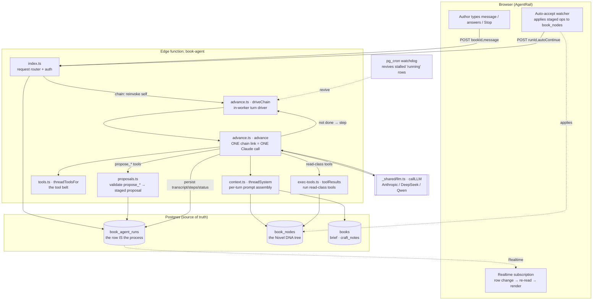
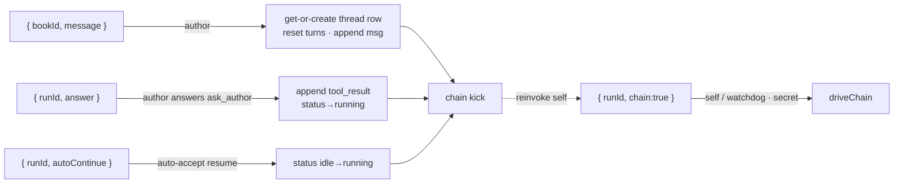
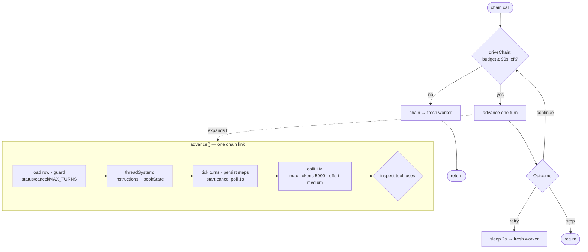
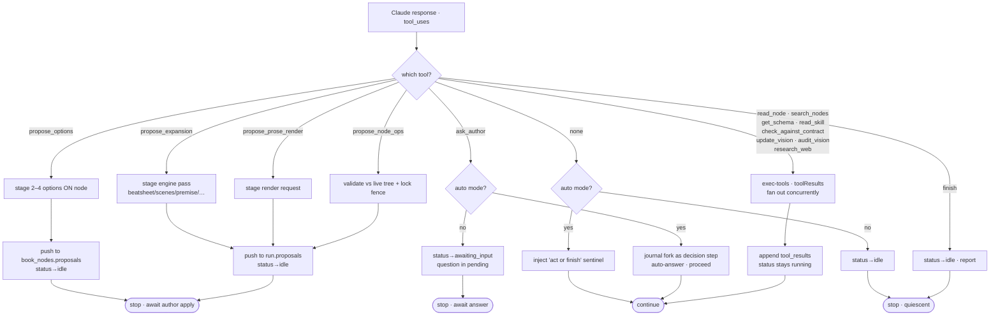
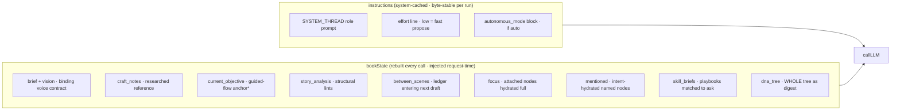
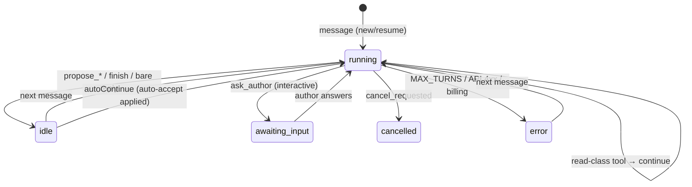
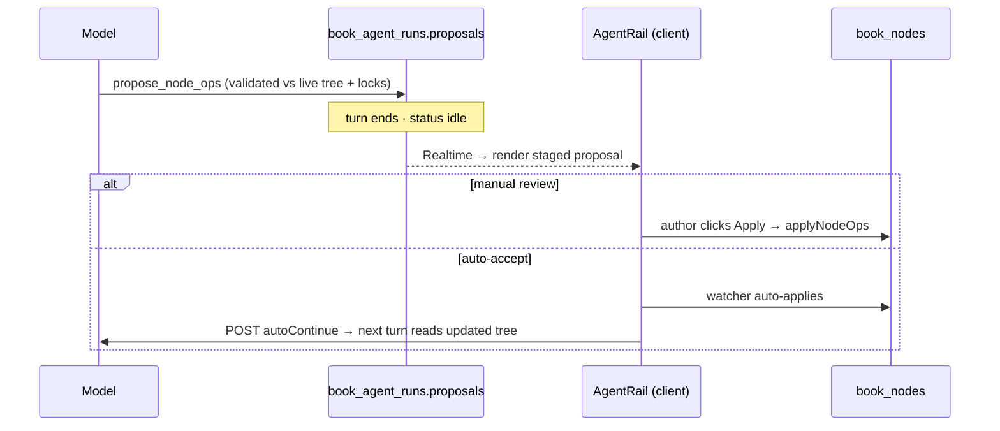

# Agent Architecture — Diagram

Visual map of the **book-agent**: the book's ONE tool-using story-editor. Diagram-first companion to
`agent-runtime-architecture.md` (which is the pure-plumbing prose) and `agent-rail.md` (the product
intent). Everything below is grounded in `supabase/functions/book-agent/*.ts` as of 2026-07-15.

**The one idea:** the agent is not a process in memory — it is **one database row**
(`book_agent_runs`, `kind='thread'`, one per book). Compute is disposable: an edge-function worker
reads the row, does one turn, writes it back, and dies. Any worker (or the watchdog cron, or a
second tab) resumes from the row alone. *Architectural term: externalized/durable state — stateless
compute over stateful storage.*

---

## 1. The whole system at a glance



**Read this as:** the client only ever *kicks* the loop (a POST) and *watches* the row (Realtime).
All thinking happens inside the durable loop. The agent **never writes `book_nodes` itself** — it
stages proposals; the client applies them.

---

## 2. Request entry paths (`index.ts`)

Four shapes of POST hit the same function. Only `chain` is machine-authenticated (a shared secret);
the rest are the authenticated author.



- **message** — the persistent omni-rail conversation. A turn ends in `idle` (not `done`), so the
  next message resumes with full transcript context. One thread per book.
- **answer** — resumes a run parked in `awaiting_input` by `ask_author`.
- **autoContinue** — the auto-accept live loop: client applied the last staged change to the tree,
  now asks the agent's next turn to read the *updated* tree. Pure status flip, no transcript edit.
- **chain** — the cross-worker self-invoke; drives the next turn.

---

## 3. The durable loop — `driveChain` → `advance`

`driveChain` runs turns **back-to-back in one worker** while wall-clock budget remains, then hands
off to a fresh worker at the boundary — avoiding a reinvoke + cold boot per logical turn. Each
individual Claude call still fits the ~150s worker cap, so durability holds.



**Turn budget & guards** (`advance.ts`):

| constant | value | why |
|---|---|---|
| `MAX_TURNS` | 20 | interactive runaway guard |
| `AUTO_MAX_TURNS` | 100 | autonomous builds iterate change-by-change |
| `CALL_TIMEOUT_MS` | 140_000 | one call must fit the ~150s worker cap |
| `max_tokens` | 5000 | ~55 tok/s decode → all that fits the timer |
| `output_config.effort` | `medium` | HIGH thought past the timer (billed aborts) |

Turns are counted **before** the call, so a mid-call worker death still burns budget and a
crash-looping run hits the ceiling instead of being revived forever.

---

## 4. Tool dispatch — where a turn ends (`advance` L5)

Two tool *classes*. **Read-class** tools execute inline and the loop continues. **Terminal**
(`propose_*` / `finish` / `ask_author`) end the turn — the agent is read-only on `book_nodes`, so
every write goes out as a *staged proposal* the author (or auto-accept) applies.



**Read-class vs terminal** is the load-bearing distinction: reads compose (batch them in one turn),
proposals are the only exit and each ends the turn. A rejected proposal (fails validation against the
live tree / lock fence) is handed back as the failing tool's result so the next turn can correct.

---

## 5. Per-turn context assembly (`context.ts · threadSystem`)

Prompt is split for **prompt-cache prefix discipline**: a byte-stable `instructions` block (cached)
plus a volatile `bookState` injected at the *end* of the latest user message — so the changing tree
never invalidates the cached prefix.



Key mechanisms:

- **Tree digest** — the whole tree ships every turn, but each node is a one-line digest
  (handle/gist + causal + meter spine). Full content is one `read_node` away. Keeps tokens bounded.
- **Intent hydration** — nodes the *message* names (by "scene 14", node id, or entity name) get
  their full plan + a named scene's prose inlined, deterministically (regex + DFS numbering) — no
  `read_node` round-trip to act on the ask.
- **Three-state objective** *(\*)* — a concrete typed ask OMITS the objective; an empty ask, the
  "Next" nudge, or `auto` injects it (in auto it IS the work queue).
- **Live re-derivation** — objective, analysis, ledger are recomputed from the *current* tree each
  link (same engine the web client runs), so an auto resume advances on its own.
- **Discovery gate** — mid-interview (vision not compiled, building not started) pins the
  `vision-interview` skill and suppresses ask-triggered skills.

---

## 6. The row as a state machine



`status` is the cursor; `transcript` is the agent's real memory; `steps` is the human-readable feed
the chat renders; `proposals`/`pending` hold staged output. The watchdog cron only revives stalled
**running** rows — parked (`awaiting_input`) and quiescent (`idle`) runs are left alone.

---

## 7. The proposal review channel (why the agent can't corrupt the book)



There is **no path from the agent straight to `book_nodes`**. Every mutation is a validated,
reviewable proposal applied through the existing write path (`applyNodeOps`, the v2 prose pipeline,
or the `dna-expand` engine). This is the safety invariant of the whole design.

---

## Where each piece lives

| Concern | File |
|---|---|
| Request router + auth | `index.ts` |
| Loop driver + one chain link | `advance.ts` (`driveChain`, `advance`) |
| Per-turn prompt assembly + tree digest | `context.ts` (`threadSystem`) |
| Tool schemas (the belt) | `tools.ts` (`threadToolsFor`) |
| Read-class tool execution | `exec-tools.ts` (`toolResults`) |
| propose_* validators → staged proposals | `proposals.ts` |
| System prompt text | `prompts.ts` (`SYSTEM_THREAD`) |
| render→verify injection (auto) | `verify.ts` |
| eager ack + thread titling | `ack.ts` |
| transcript compaction / cache breakpoints | `transcript.ts` |
| Row shape + shared types | `shared.ts` |
| LLM chokepoint (provider convert + logging) | `_shared/llm.ts` |
| Self-chain reinvoke + secret | `_shared/self-chain.ts` |
```

