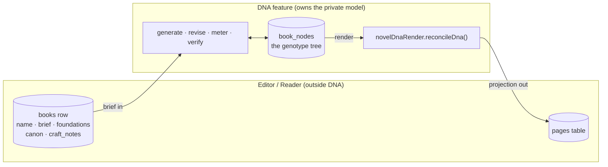
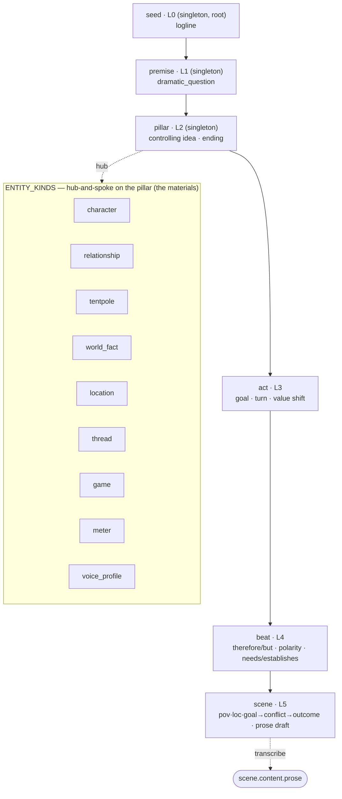
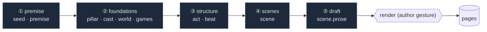
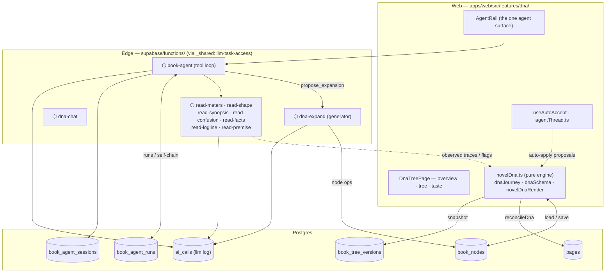
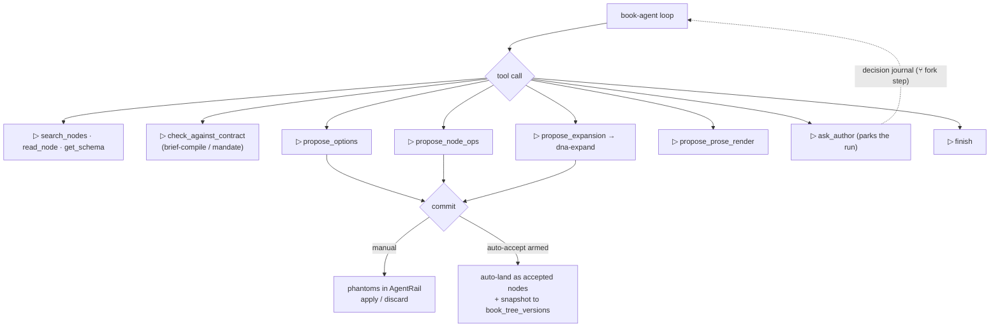
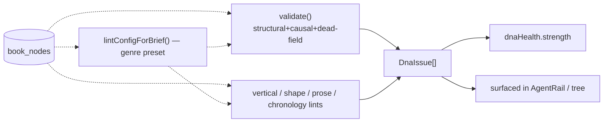
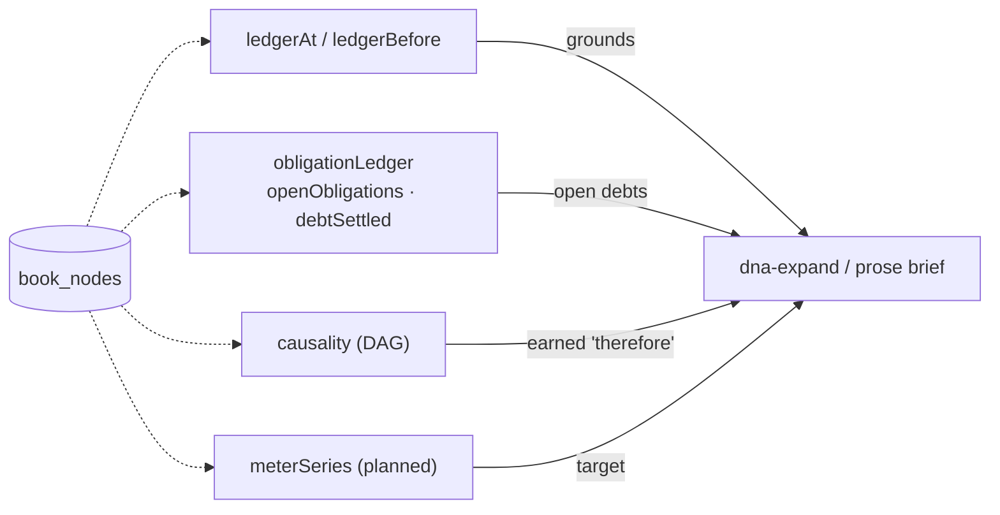
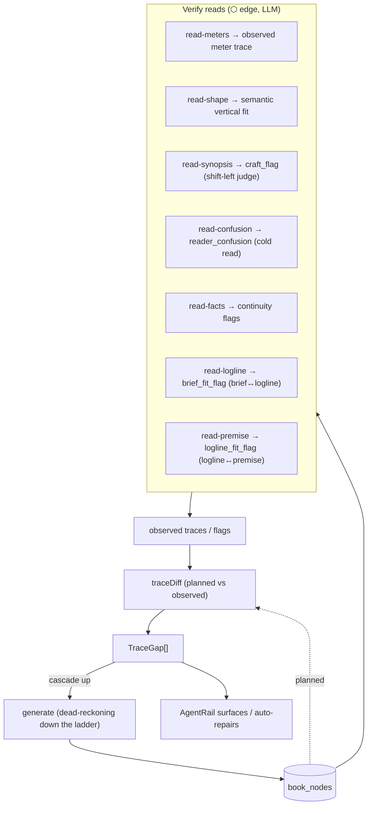
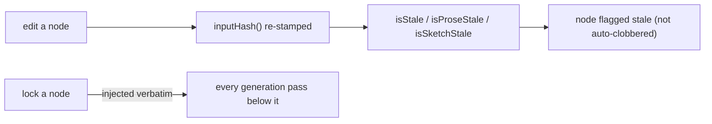

# Novel DNA — Architecture Map

> Dev-facing map of **everything involved in building a book**: the tree, the
> generators, the linters, the ledgers, the verify reads, the driver, and how
> information flows between them. Not book-specific. Diagrams over prose.
>
> Source of truth for names: `apps/web/src/features/dna/lib/novelDna.ts` (engine),
> `dnaJourney.ts` (driver), `dnaSchema.ts` (schema+lints), the `read-*` edge fns,
> and `book-agent` (agent tools). Companion tour: `00-pipeline-overview.md`.

**Legend** — `▭` store/table · `( )` pure engine fn · `⬡` edge fn · `▷` agent tool
· solid arrow = data flow · dashed arrow = derives/validates (no storage).

---

## 1 · The seam (books-in / pages-out)

DNA owns a private model; it couples to the rest of the app through two narrow
contracts only.

- **Entry** = `books` row (editor writes `brief`, `foundations`, `canon`, `craft_notes`).
- **Private** = `book_nodes` (+ `book_agent_runs`, `book_agent_sessions`, `dna_chats`, `book_tree_versions`). Nothing outside DNA touches these.
- **Exit** = `render` reconciles the tree → `pages`. Render/publish are **deliberate author gestures** — the agent cannot cross the seam.

---

## 2 · The tree (the genotype)

The whole book is one self-similar `book_nodes` tree. Two kind families, one
strict parent law (`PARENT_KIND`, `SINGLETON_KINDS`).

- `LADDER_KINDS = seed → premise → pillar → act → beat → scene` — a **typed
  ordered sequence**; each rung down is **higher resolution, lower authority over causality**.
- `ENTITY_KINDS` hang off the pillar via `PARENT_KIND`; `SINGLETON_KINDS = seed·premise·pillar·voice_profile`.
- Every node carries an **authorship plane** (`Authoring`): `source` (authored / derived / instrument) · `status` · `locked`.

---

## 3 · The build journey (five gated stages)

`dnaJourney.ts` walks the tree down. Each stage is **locked until the prior
completes** (`stageComplete`); `currentObjective` derives the one next rung live
and injects it as an *anchor, not a fence*.

`STAGE_KINDS` (which node kinds satisfy each gate):

| Stage | Kinds that fill it | Produced by | Key mechanic |
|---|---|---|---|
| `premise` | seed, premise | `dna-expand·logline`, agent `propose_options` | idea ≠ logline (first refinement) |
| `foundations` | pillar, character, relationship, tentpole, world_fact, game | agent + `node_type_configs` | hub-and-spoke; pins propagate down |
| `structure` | act, beat | one **global beat-sheet pass** | `needs`↔`establishes` = causal DAG |
| `scenes` | scene | per-beat `propose_expansion(scenes)` | projection, not re-invention |
| `draft` | scene (prose) | `prepare` + browser off-worker stream | escapes ~150s worker ceiling |

`dnaHealth()` scores the tree live: **completeness** (`0.5·stagesDone + 0.5·contentFill`)
and **strength** (`1 − lint penalty`, errors weigh 2.5× warns), plus render `blockers`.

---

## 4 · Full information flow (the system)

How a build request travels web → edge → DB → render, and how the private tree
feeds every derived view. All derived views are **pure functions of the tree** —
nothing below `book_nodes` is stored.

**Deploy split** (physically two targets, logically one feature):

| Layer | Where | Notes |
|---|---|---|
| Web engine + UI | `apps/web/src/features/dna/` | pure engine runs client-side; read `FEATURE.md` first |
| Edge fns | `supabase/functions/<name>/` | ride shared kernel `_shared/{llm,task,access,brief}.ts` |
| Dev bridge | `scripts/eval-bridge.mjs` | reimplements the edge pipeline for `localhost:8787` — **every edge change must mirror here** |
| Schema lock | `_shared/dna-schema.json` ↔ `lib/dnaSchema.ts` | `dnaSchema.artifact.test.ts` fails on drift |

---

## 5 · The driver (agent + propose/commit)

One tool-using agent thread per book (`book-agent`). Generation has **two exits**:
auto-land as accepted nodes, or reviewable ops (phantoms → apply/discard in AgentRail).

- **Auto-accept** (`context_auto` flag + `useAutoAccept`): agent picks its own
  options and applies via the same manual apply paths — can walk the whole ladder.
- Each auto-mode creative choice is journaled as a **decision fork** (`⑂`) step (question + options + timestamp) in `agentThread`.
- Auto-accept arm **auto-checkpoints** a tree version (`snapshot_book_tree` RPC) for diff/restore.

---

## 6 · Linters (the sensing half)

Generation down the ladder is **dead-reckoning**; linters + prose read-repair are
the sensing half. Grouped by engine section. `validate(nodes)` aggregates
structural + causal + dead-field into `DnaIssue[]`; verticals/prose/sketch run per surface.

| Family | Codes | Fn / source | Sev |
|---|---|---|---|
| **Structural** | `orphan`, `misparented` | `structuralLints()` → `validate()` | error |
| **Promise / debt** | `misordered_payoff`, `unearned_payoff` | `enforcePromiseSchedule()` on `promiseLedger` | `misordered`=error |
| **Causal (why)** | `uncaused_therefore` | `causality()` — `needs`/`establishes` DAG | error |
| **Vertical fit** | `movement_unfit`, `act_value_undelivered`, `beat_polarity_undelivered`, `scene_reading_departs` | vertical-fit / timeline layer | warn |
| **Shape read** | `shape_unmapped`, `ending_feel_mismatch`, `craft_flag` | `buildShapeReadInput` + `read-shape` / `read-synopsis` | warn |
| **Brief / premise read** | `brief_fit_flag`, `logline_fit_flag` | `buildBriefFitInput` + `read-logline`; `buildLoglineFitInput` + `read-premise` | warn |
| **Sketch** | scene-treatment lints | SKETCH LINTS section | warn |
| **Prose** | deterministic read-layer flags | `proseLints()` | warn |
| **Dead-field** | `dead_arc`, `static_relationship` | DEAD-FIELD LINTS (declared-never-consumed) | warn |
| **Chronology** | `unmarked_travel` | CHRONOLOGY LINTS (timeline floor) | warn |
| **Cold read** | `reader_confusion` | `confusionRead` / `read-confusion` | warn |

`LintConfig` (the linter's `.eslintrc`) is derived per-book from the brief via
`lintConfigForBrief()` — genre presets tune which lints fire and how hard.

---

## 7 · Ledgers (computed views over the tree)

Every ledger is a **pure derivation** — the tree is the only store. They give the
generator grounded context ("story so far") and the verifier something to diff against.

| Ledger | Fn(s) | What it is |
|---|---|---|
| **Continuity / fact** | `ledgerBefore` · `ledgerFull` · `ledgerText`, `factLedger.ts`, `read-facts` | prefix-sum "story so far" up to a scene |
| **Entity registry** | `entityRegistryBlock` | shared keyspace so refs resolve to one id, not two spellings |
| **Facet exposure** | `facetExposureBefore` · `facetEchoes` | progressive disclosure — what the reader knows so far |
| **Between-scenes (unified)** | `ledgerAt` | the one id-keyed read composing the three above |
| **Promise / obligation debt** | `promiseLedger` · `obligationLedger` · `openObligations` · `debtSettled` | book = ledger of promises; completion = debt settled |
| **Causality spine** | `causality` · `cascade` · `stakesOf` · `blastRadius` | the `needs`/`establishes` DAG (the "and-then" killer) |
| **Meters** | `meterShape` · `meterSeries` · `observedSeries` · `targetGap` · `observedGap` · `traceDiff` | plottable axes (comedy/heat/tension…): planned vs observed |
| **Decision journal** | `agentThread` fork steps | auto-mode creative choices, journaled (`⑂`) |

---

## 8 · The verify loop (generate ↔ verify)

The "true agent" duality: after generating, an **experiential read** produces
observed traces; `traceDiff` compares observed vs planned; the gap can **cascade a
fix back up** the ladder. Reads are paid LLM passes; lints are the deterministic floor.

**Prose is a special two-hop** (escapes the worker ceiling): `prepare` assembles
the prompt (+ a curated render brief: focus·mustHonor·avoid), the **browser streams
off-worker**; a rolling incremental digest (`prose_digest`, src/prev hash chain)
keeps continuity at O(1)/page; read-repair fixes the tail.

---

## 9 · Staleness & provenance (the cross-cutting strand)

Runs through every rung. Keeps derived rungs honest when an upstream node changes,
and carries author intent verbatim downward.

- **Hash chain**: `inputHash` / `stampInput` / `stampProse` / `stampSketch`;
  `isStale` compares the current input-set hash to the stamped one.
- **Locks**: a `locked` node is injected verbatim into every downstream pass — a hard constraint pins propagate as.
- **Provenance**: every node stamped `source` · `status` · `locked` (`Authoring`).

---

## 10 · Data model

| Table | Owner | Role |
|---|---|---|
| `books` | editor | entry contract: brief, foundations, canon, craft_notes, `context_auto` |
| `book_nodes` | DNA | the genotype tree (single source of truth) |
| `book_agent_runs` | DNA | durable agent run rows (waitUntil / self-chain) |
| `book_agent_sessions` | DNA | archived AgentRail threads (off the runs jsonb) |
| `book_tree_versions` | DNA | linear save points (`snapshot_book_tree` RPC) |
| `dna_chats` | DNA | chat surface state |
| `pages` | editor/reader | **exit projection** (render target, never edited by agent) |
| `ai_calls` | shared | every LLM call logged via `_shared/llm.ts` chokepoint |

---

## 11 · Recent changes (what landed lately)

- **Brief/premise reads** (2026-07-11): two new craft judges close the gap between
  the deterministic logline anatomy lints and the shape/synopsis reads — `read-logline`
  (`brief_fit_flag`, does the logline still honor the brief?) and `read-premise`
  (`logline_fit_flag`, does the premise still honor the logline's protagonist/inciting/
  goal/obstacle/stakes as FIXED — the `dnaJourney.ts` premise-stage contract, previously
  unchecked). Grounded in `craft-kb.ts`'s `LOGLINE_CRAFT` and `PREMISE_JUDGE_CRITERIA` —
  the latter shared with `dna-expand`'s premise-generation self-eval, which previously
  scored itself and discarded the scores.
- **Verify layer** (2026-07-06): `LintConfig` + genre presets, brief-compile
  (`check_against_contract`), synopsis read (`craft_flag`), `proseLints`, arc
  threads (`dead_arc` / `static_relationship`), cold read (`reader_confusion`),
  decision journal (`⑂` fork), `unmarked_travel`.
- **Timeline layer + vertical-fit lints** (2026-07-04): `shape_unmapped`,
  `ending_feel_mismatch`, `beat_polarity_undelivered`, `scene_reading_departs`;
  shape read = paid semantic ceiling of vertical fit (`movement_unfit`).
- **Scene ledger unification** (2026-07-03): three between-scenes reads folded into
  `ledgerAt` (id-keyed) + `entityRegistryBlock` + facet exposure.
- **Obligation ledger**: debt-based completion (`obligationLedger` / `openObligations` / `debtSettled`).
- **Tree versions** (2026-07-02): save points + diff-since-last + restore.
- **One-studio consolidation** (2026-07-03): DnaTreePage is the ONE surface
  (overview · tree · taste); vanilla `/dna` studio deprecated.

All engine changes are **parity-locked** across the web engine and the edge twin
(`novelDna.parity.test.ts`); the schema artifact lock guards `dnaSchema.ts` ↔ `dna-schema.json`.
